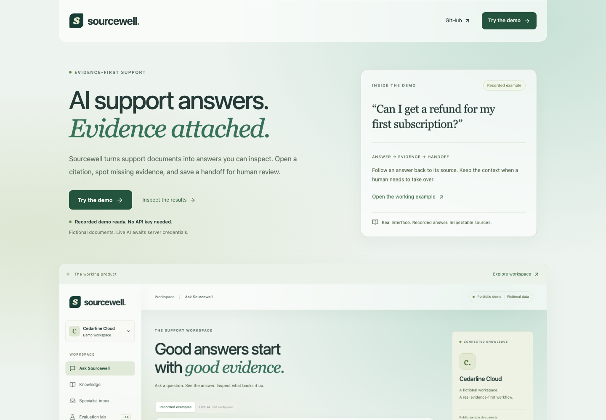
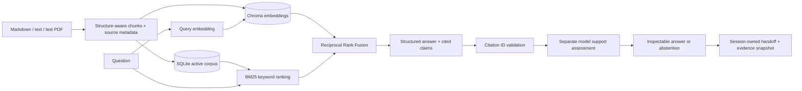
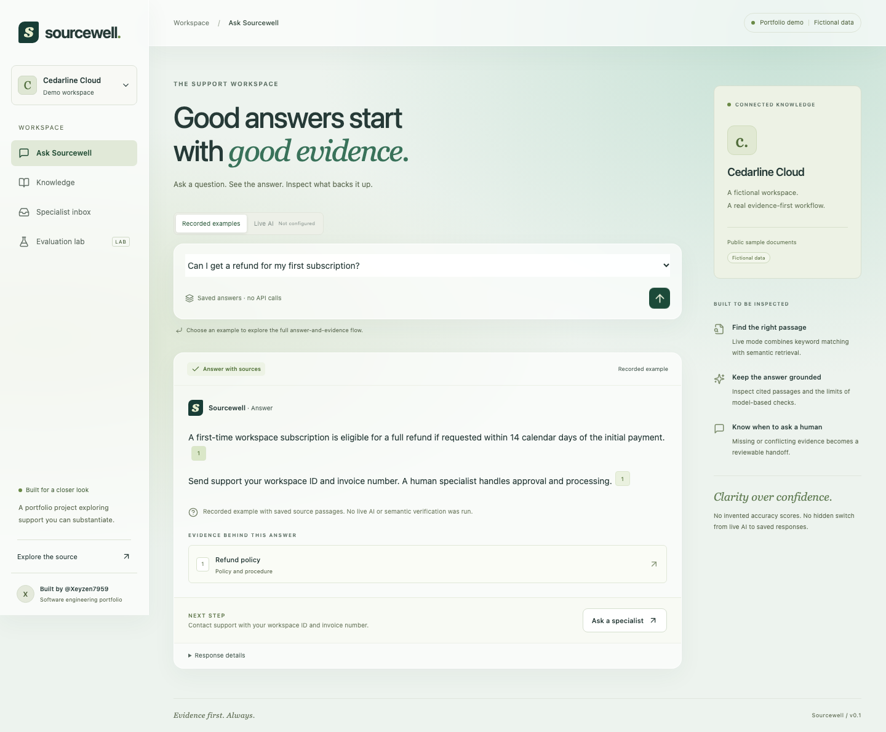

<div align="center">

# Sourcewell.

**Support answers with evidence you can inspect.**

React + TypeScript · FastAPI · Chroma · BM25 · Reciprocal Rank Fusion

[](https://github.com/Xeyzen7959/sourcewell/actions/workflows/checks.yml)

[Get started](#get-started) · [Architecture](#how-it-works) · [Evaluation](evaluation/README.md) · [Learning guide](docs/LEARNING.md)

</div>



Sourcewell is a working portfolio application for answering support questions from company documentation. It connects document ingestion, hybrid retrieval, structured generation, inspectable citations, and human handoff in one small application.

The sample company, **Cedarline Cloud**, and all 24 seeded documents are fictional. One conflicting policy pair and one malicious source instruction are deliberate evaluation fixtures.

## What you can explore

- **Interface:** light glass surfaces, forest-green text, short purposeful motion, reduced-motion support, and solid-surface fallbacks. [Design and verification record](docs/WEBSITE_BRAIN_REVIEW.md).
- **Introduction:** try the product directly, inspect the actual workspace screenshot, and see artifact-backed results or an explicit pending state. No video is required. The workspace remains directly accessible at `/#ask`.
- **Ask:** select a recorded scenario, or use live AI after server configuration. Open the exact passages behind each citation.
- **Knowledge:** search and preview source documents. Authorized local administrators can upload, replace, index, and delete their own documents.
- **Inbox:** save a handoff with its answer attempt and source snapshots. Review notes, draft a reply, and update status. Tickets persist in SQLite and belong to the current browser session.
- **Evaluation lab:** inspect 60 cases and their development/held-out splits. Local administrators can record human corrections and quality grades, with reviewer identity and UTC review dates. View actual evaluator artifacts when available; no scores appear before a live run.

Recorded examples are explicitly labeled. They do not run retrieval or AI, and failed live requests never silently become saved examples.

## Get started

### Docker Compose

Requires Docker with Compose. From the repository root:

```bash
cp .env.example .env
docker compose up --build
```

Open **http://localhost:8000** and select **Try the demo**. Recorded examples work without a provider key. Application data persists in the named `sourcewell-data` volume. The published port binds to loopback only.

### Without Docker

Requires Python 3.12, [uv](https://docs.astral.sh/uv/), Node.js 24, and pnpm 11.25.0.

```bash
cp .env.example .env
uv sync --frozen --extra dev
cd frontend
pnpm install --frozen-lockfile
pnpm build
cd ..
uv run python -m uvicorn backend.main:create_app --factory --host 127.0.0.1 --port 8000 --no-access-log
```

Open **http://127.0.0.1:8000**. FastAPI serves the built frontend and API on the same origin. The fictional corpus is seeded at startup without external calls.

For frontend development, keep the API running on port 8000 and run `pnpm dev` inside `frontend/`. Vite proxies `/api` to the local server. Rebuild before testing the production interface.

## Enable real AI

Sourcewell supports direct OpenAI requests and **Vercel AI Gateway**, using the existing official OpenAI Python SDK for both. Select one explicitly; there is no automatic provider fallback.

### Reuse a Vercel Gateway account

Velosync's deployment can authenticate using Vercel OIDC. That deployment identity is not a permanent API key to copy into Sourcewell. Local/external hosting should use an AI Gateway API key from the same Vercel account/team; usage shares that account's credits, billing, and limits.

Configure these values only in the ignored local `.env` or your host's server-side secret settings:

```dotenv
AI_PROVIDER=vercel
AI_GATEWAY_API_KEY=
GENERATION_MODEL=google/gemini-2.5-flash-lite
EMBEDDING_MODEL=openai/text-embedding-3-small
```

Fill the key privately. Do not paste it into chat, copy Supabase credentials, expose it in browser code, or copy a short-lived deployment token. A separate Sourcewell Gateway key is preferable for independent spending controls. No key or budget is created automatically. Both listed model IDs were present in the live Gateway catalog on 2026-10-25; actual account access still requires a live check.

Sources: [Gateway authentication](https://vercel.com/docs/ai-gateway/authentication-and-byok), [Responses compatibility](https://vercel.com/docs/ai-gateway/sdks-and-apis/responses), [live model catalog](https://ai-gateway.vercel.sh/v1/models).

### Direct OpenAI setup

1. Set `OPENAI_API_KEY` on the server in `.env`. ChatGPT/Codex access does not itself supply an API key or API credits.
   Set `AI_PROVIDER=openai`, `GENERATION_MODEL=gpt-6-luna`, and `EMBEDDING_MODEL=text-embedding-3-small` for this route.
2. Set a strong `ADMIN_TOKEN` for local document administration. For example, generate one with `python -c "import secrets; print(secrets.token_urlsafe(32))"`. Never commit the generated value.
3. Restart the server. In Knowledge, choose **Administrator access**, enter the token, and choose **Index all for live search**. Alternatively run the index command below.
4. In Ask, switch to **Live AI**. Choose semantic or hybrid retrieval and ask your own question.

```bash
# Real embedding calls; requires a provider key.
uv run python -m scripts.manage index

# Explicit paid-provider check; no mocks or fixture substitution.
uv run python -m scripts.live_smoke
```

For either provider, configure a local `ADMIN_TOKEN`, restart, and index the corpus before live questions. Docker equivalents: `docker compose exec --user 10001:10001 sourcewell /app/.venv/bin/python -m scripts.manage index` and `docker compose exec --user 10001:10001 sourcewell /app/.venv/bin/python -m scripts.live_smoke`.

Default models are configurable: `gpt-6-luna` for generation/support assessment and `text-embedding-3-small` for embeddings. Account access and model compatibility must be verified with your own live smoke check. Changing embedding models creates a separate vector collection and requires indexing again.

### Provider limits and cost

The default global cap is **100 reserved provider operations per UTC day**, persisted in SQLite. One normal answer can use three operations: query embedding, generation, and citation assessment. Initial indexing uses additional operations. Failed calls also consume reservations; automatic provider retries are disabled. Calls use a 35-second timeout and generation is capped at 4,000 output tokens per operation.

The cap is an application safeguard, **not a guaranteed dollar budget**. Configure provider-side spending controls too. Optional per-million-token prices enable estimated response costs. Blank prices display “unavailable,” never zero. Estimates exclude unknown usage from failed calls and are not billing records.

## How it works



Semantic mode skips BM25 fusion. Hybrid mode combines ranks rather than mixing incompatible similarity and keyword scores. The final context size and candidate count are configurable.

Only active SQLite chunk IDs are eligible for vector retrieval. A replacement changes the active chunks atomically; old vectors cannot become search results even if cleanup is interrupted. Saved answers intentionally retain historical evidence snapshots. See [architecture decisions](docs/ARCHITECTURE.md).



## Quality and evaluation

**No live AI quality benchmark has been run.** No usable OpenAI or Gateway key was available locally. Offline tests verify behavior using deterministic doubles and SDK MockTransport; they are not evidence of real model accuracy or Gateway account connectivity.

The 60-case dataset is **AI-drafted and requires human review**. It is not human-labeled ground truth. Development and held-out cases are kept separate. Read [the evaluation protocol](evaluation/README.md) before making portfolio quality claims.

```bash
# Start with a small paid smoke comparison.
uv run python -m scripts.evaluate --split development --limit 2

# Inspect work size without calling a model.
uv run python -m scripts.evaluate --split development --estimate

# Only after an explicit budget decision; raising the default cap may also be necessary.
uv run python -m scripts.evaluate --split development --confirm-paid-run

# Final assessment only; do not tune on this split.
uv run python -m scripts.evaluate --split held_out --confirm-held-out --confirm-paid-run
```

The evaluator uses an isolated seed-only index under `data/evaluation`, so uploaded local documents do not contaminate the comparison or its exported answers. Its provider reservations still count toward the application's shared daily cap. It records dataset/corpus fingerprints, models, settings, time, failures, document-level Recall@k, citation-reference checks, model support assessments, abstention, tokens, and optional cost estimates. Answer correctness requires a separate human rubric review. It does not infer correctness from a model’s confidence.

### Review annotations and answers

In local mode, set `ADMIN_TOKEN`, open Evaluation lab, and select a case. Inspect its annotated documents, correct the question/expectation/source IDs, enter your reviewer name, and explicitly attest to checking the evidence. The server records the date. An AI tool must not make this attestation for you.

Reviews persist in `DATA_DIR/reviews.json`. Export them with **Export human reviews**, or run `uv run python -m scripts.manage export-reviews` to update the versioned `evaluation/reviews.json`. Inspect that diff before committing reviewer identities. Split membership stays fixed. Changed base datasets or corpus files invalidate old attestations instead of silently carrying them over.

After a live run, select an outcome to inspect the answer, exact source passages, expected behavior, and errors. Local reviewers can assign a rubric grade and justification. Grades attach to that exact run fingerprint and case/mode. A partial review never appears as a grade for the entire dataset.

## Run the checks

```bash
uv run ruff check backend scripts
uv run python -m pytest -q
cd frontend
pnpm typecheck
pnpm lint
pnpm build
pnpm exec playwright install chromium
pnpm test:e2e
```

Playwright runs the built app against temporary local and public FastAPI/SQLite servers on ports 8001 and 8002, without a provider key. It checks desktop and mobile introduction/demo navigation, narrow 320px layouts, keyboard route focus, reduced motion, glass/motion enhancement, screenshot fallback, evaluation loading/errors, answer/citation/handoff flows, persisted ticket edits, human-review/export controls, public restrictions, and budget-exhausted states. Test-entered reviewer records are temporary fixtures, never real dataset validation. On Linux, install browser dependencies with `pnpm exec playwright install --with-deps chromium`.

To refresh application screenshots deliberately: `UPDATE_SCREENSHOTS=1 pnpm test:e2e`. GitHub Actions runs deterministic checks without paid calls or secrets, then builds and boots the real Docker image with a persistent test volume. Container checks verify non-root serving, readiness, secure-cookie flags, static assets, and recorded answers.

## Data, access, and deployment limits

- Local mode is intended for a developer using a loopback server. Uploaded documents are workspace-wide, not user-private. Administrative writes require the server-side token.
- `APP_MODE=public` requires `COOKIE_SECURE=true`, disables document/review administration, and excludes uploaded documents from public document/search endpoints. Seed documents remain read-only. Public session identities use a separate namespace, so switching modes cannot expose local administrator handoff history.
- Tickets and answers use a random 256-bit HttpOnly session cookie. This provides browser-session isolation, not user accounts or durable identity. Clearing cookies loses access to that session’s tickets. No shared public inbox is exposed.
- Source content renders as text; it cannot inject HTML. Document instructions are passed as untrusted evidence, with no model tools or external actions. Prompt-injection robustness still needs live/adversarial evaluation.
- Uploads accept UTF-8 Markdown/text and unencrypted text PDFs, at most 2 MB and 50 PDF pages by default. Scanned PDFs require OCR, which is not included.
- The application uses one server process and a local vector store. In-memory per-IP rate limits and live concurrency slots are not distributed. A public deployment requires HTTPS, secure cookies, a carefully trusted proxy, and provider budget controls. See the prepared [deployment proposal](docs/DEPLOYMENT.md); no resources are created by adding its configuration to Git.
- Public answers and handoffs expire after 24 hours by default. Endpoints reject expired records immediately; a startup/hourly cleanup removes expired public rows. Local history and provider usage reservations are preserved. A random session cookie is a bearer credential, not account authentication.
- A per-process live concurrency cap rejects excess live work without blocking recorded examples. Request bodies are bounded before parsing, including chunked requests. Daily provider limits remain persisted and atomic.

### Seed and reset

```bash
# Idempotent fictional seed; does not delete local uploads or call AI.
uv run python -m scripts.manage seed

# Expired public records only; preserves local history and the spending ledger.
uv run python -m scripts.manage cleanup

# Destructive: stop the server and back up ./data first.
uv run python -m scripts.manage reset --confirm DELETE_LOCAL_SOURCEWELL_DATA
```

Reset refuses custom DATA_DIR locations. Docker data lives in its named volume; back it up before any manual volume removal. Do not run reset while the application is using the database.

## Configuration

| Variable | Default / purpose |
| --- | --- |
| `OPENAI_API_KEY` | Empty; recorded examples remain available |
| `AI_PROVIDER` / `AI_GATEWAY_API_KEY` | `openai` by default; choose `vercel` and a private Gateway key to use that account |
| `GENERATION_MODEL` | `gpt-6-luna`; structured generation and support checks |
| `EMBEDDING_MODEL` | `text-embedding-3-small` |
| `DATA_DIR` | `./data`; ignored local databases and vectors |
| `APP_MODE` | `local`; `public` restricts access to fictional seed documents |
| `ADMIN_TOKEN` | Empty; document administration disabled until configured |
| `COOKIE_SECURE` | `false` for loopback HTTP; use `true` with public HTTPS |
| `PUBLIC_ORIGIN` | Optional fixed HTTPS origin for CSRF checks behind an internal HTTP proxy; Render entry point derives it from `RENDER_EXTERNAL_URL` |
| `DAILY_PROVIDER_CALL_LIMIT` | `100`; persisted cap, including failed reservations |
| `REQUESTS_PER_MINUTE` | `20`; per client IP per application process |
| `MAX_CONCURRENT_LIVE_REQUESTS` | `2`; rejected work is not queued indefinitely |
| `SESSION_RETENTION_HOURS` | `24`; public answers/tickets only |
| `MAX_JSON_BYTES` | `16384`; checked before JSON parsing |
| `MAX_UPLOAD_BYTES` | `2000000` |
| `CHUNK_SIZE` / `CHUNK_OVERLAP` | `1200` / `150` characters; overlap must be smaller |
| `RETRIEVAL_CANDIDATES` / `CONTEXT_CHUNKS` | `10` / `5` |
| `RRF_K` | `60` rank-fusion constant |
| `GENERATION_INPUT_PRICE` / `GENERATION_OUTPUT_PRICE` | Optional USD per million tokens |
| `EMBEDDING_INPUT_PRICE` | Optional USD per million input tokens |

Advanced variables are read directly by the non-Docker server. Add them to Compose’s environment mapping if overriding them in Docker.

## Project map

```text
backend/       API, access rules, retrieval, provider integration, persistence, tests
frontend/      Accessible React workspace and browser tests
fixtures/      Fictional documents and explicitly recorded examples
evaluation/    Draft questions, review protocol, and optional real result artifact
scripts/       Seed, index, reset, live smoke, and live comparison commands
docs/          Architecture decisions, learning guide, demo script, screenshots
```

Built by [@Xeyzen7959](https://github.com/Xeyzen7959).
